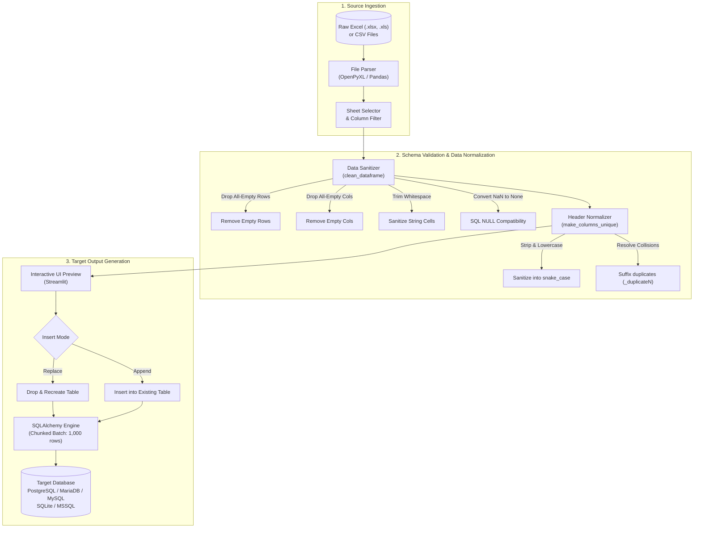

# 🚀 SheetPusher: Zero-Setup Spreadsheet-to-Database ETL Pipeline

<div align="center">

[](https://www.python.org/)
[](https://streamlit.io/)
[](https://pandas.pydata.org/)
[](https://www.sqlalchemy.org/)
[](https://openpyxl.readthedocs.io/)
[](LICENSE)
[](https://fauzanlm-sheetpusher-app-x9yvji.streamlit.app/)
[](tests/)

**An interactive, zero-setup ETL & spreadsheet normalization pipeline that automates the transition from messy business spreadsheets to database-ready SQL schemas.**

[Explore Live Demo](https://fauzanlm-sheetpusher-app-x9yvji.streamlit.app/) • [Report Bug](https://github.com/fauzanlm/SheetPusher/issues) • [Request Feature](https://github.com/fauzanlm/SheetPusher/issues)

</div>

---

## 💡 The Problem & Philosophy

In modern data ecosystems, operational teams and business units fundamentally rely on spreadsheets (**Microsoft Excel** and **CSV** files). However, human-maintained spreadsheets are notorious for harboring schema and data-quality defects:

- **Inconsistent and illegal column identifiers**: Headers like `"  Order ID # "`, `"Unit Price ($/hr)"`, or nested spaces that cause SQL syntax failures.
- **Duplicate column headers**: Multiple columns sharing identical names (e.g. two separate `"Customer Email"` columns), triggering silent overwrites or import crashes.
- **Dirty data values**: Untrimmed trailing/leading whitespaces, arbitrary empty rows, blank padding columns, and missing values improperly represented as string `"NaN"`.
- **Engineering bottleneck**: Data Engineers and BI Analysts waste hours writing ad-hoc throwaway scripts or manual macros just to ingest a spreadsheet into a data warehouse or operational database.

### 🎯 The Solution: SheetPusher

**SheetPusher** serves as an intelligent ingestion buffer and data normalization layer. It empowers analysts and engineers to drop raw spreadsheets into an intuitive web interface, automatically scrubs and standardizes the schema into compliant `snake_case` identifiers, eliminates data anomalies, and streams clean records directly into relational databases with transactional integrity.

---

## 🏗️ Architecture & ETL Pipeline

SheetPusher follows a four-stage Extract-Transform-Load (ETL) pipeline:



### ASCII Pipeline Overview

```text
[ Raw Spreadsheet ] ────> [ Sheet & Column Filter ] ────> [ Automated Cleansing Engine ]
 (XLSX / XLS / CSV)        (Interactive Multi-select)        │ • Whitespace Trimming
                                                             │ • Empty Row/Col Pruning
                                                             │ • NaN -> SQL NULL Conversion
                                                             ▼
[ Target SQL Database ] <── [ SQLAlchemy Stream ] <─── [ Schema Normalization ]
 (Postgres/MySQL/SQLite)     (Chunked 1000 Rows/Batch)     │ • snake_case Transform
                             (Append vs Replace Mode)      │ • Duplicate Column Deduplication
```

---

## 🔍 Before vs. After Cleansing

| Dimension | Raw Input (Messy Spreadsheet) | Standardized Database Output (SheetPusher) |
|---|---|---|
| **Header Identifiers** | `"  Order ID # "`, `"  Unit Price ($) "` | `order_id`, `unit_price` (Strict SQL `snake_case`) |
| **Duplicate Columns** | `"Customer Email"`, `"Customer_Email"` | `customer_email`, `customer_email_duplicate1` |
| **Empty Columns** | Completely empty column header `"   "` | Dropped automatically |
| **Empty Rows** | Blank rows interspersed in sheets | Dropped automatically |
| **Cell Strings** | `"   Stark Industries   "`, `" Jakarta  "` | `"Stark Industries"`, `"Jakarta"` (Whitespace trimmed) |
| **Missing Values** | `NaN`, `pd.NA`, empty cells | Python `None` (written cleanly as SQL `NULL`) |
| **Multi-Sheet Handling**| Complex multi-tab workbooks | Interactive dropdown to select individual target sheet |

---

## ✨ Key Features

- **🛡️ Intelligent Schema Normalization**: Automatically converts human headers into SQL-safe, lowercased `snake_case` identifiers, stripping unsafe characters and collapsing consecutive underscores.
- **🔄 Collision-Proof Deduplication**: Detects identical column headers and applies deterministic indexed suffixes (`_duplicate1`, `_duplicate2`) to prevent data loss.
- **🧹 Automated Data Hygiene**: Strips extraneous whitespaces across all string fields, drops ghost rows/columns, and formats missing data to native SQL NULLs.
- **🎯 Granular Column Selection**: Inspect, select, or omit specific columns before triggering ingestion.
- **🔌 Multi-Dialect Support**: Seamlessly connects to:
  - **PostgreSQL** (`psycopg2`)
  - **MySQL** & **MariaDB** (`mysqlconnector`)
  - **SQLite** (`sqlite3`)
  - **Microsoft SQL Server** (MSSQL)
- **⚡ Chunked Batch Loading**: Ingests datasets in configurable chunks (default: 1,000 rows) via SQLAlchemy to maintain memory efficiency and stability during bulk loads.
- **🔐 Secure Credential Management**: Database connection profiles are saved locally to `db_config.json` (strictly protected by `.gitignore`) for frictionless reuse.

---

## 🌐 Live Demo vs. Local Execution

| Environment | [Streamlit Cloud Demo](https://fauzanlm-sheetpusher-app-x9yvji.streamlit.app/) | Local Execution (Recommended) |
|---|---|---|
| **Best For** | Instant testing, reviewing features, demoing cloud databases | Production data ingestion, company networks |
| **Database Access**| Public Cloud DBs (Supabase, RDS, Neon, Cloud SQL) | **Local Databases (`localhost`)** & Cloud DBs |
| **Data Privacy** | Processed in Streamlit cloud sandbox | **100% On-Premise**: Data never leaves your machine |
| **Installation** | Zero setup required | Single command (`streamlit run app.py`) |

> [!IMPORTANT]
> To connect to local databases running on `localhost` or private internal subnets, **run SheetPusher locally**. Cloud sandboxes cannot reach your machine's private network.

---

## 🚀 Quick Start & Installation

### 1. Clone the Repository

```bash
git clone https://github.com/fauzanlm/SheetPusher.git
cd SheetPusher
```

### 2. Set Up Virtual Environment

```bash
python3 -m venv .venv
source .venv/bin/activate  # On Windows: .venv\Scripts\activate
```

### 3. Install Dependencies

```bash
pip install -r requirements.txt
```

### 4. Run the Application

```bash
streamlit run app.py
```

The application will launch in your default browser at `http://localhost:8501`.

---

## 🧪 Automated Testing Suite

SheetPusher includes a comprehensive unit and integration test suite powered by `pytest`, verifying schema normalization, whitespace sanitation, empty record elimination, and real-world sample dataset ingestion.

### Install Development Dependencies

```bash
pip install -r requirements-dev.txt
```

### Run All Tests

```bash
pytest -v
```

### Test Coverage Highlights

```text
tests/test_cleaner.py::TestColumnSanitization::test_clean_column_name_basic PASSED
tests/test_cleaner.py::TestColumnSanitization::test_clean_column_name_special_characters_and_symbols PASSED
tests/test_cleaner.py::TestColumnSanitization::test_clean_column_name_empty_or_invalid PASSED
tests/test_cleaner.py::TestColumnSanitization::test_make_columns_unique_with_duplicates PASSED
tests/test_cleaner.py::TestColumnSanitization::test_make_columns_unique_with_empty_headers PASSED
tests/test_cleaner.py::TestDataFrameCleansing::test_clean_dataframe_drops_empty_rows PASSED
tests/test_cleaner.py::TestDataFrameCleansing::test_clean_dataframe_drops_empty_columns PASSED
tests/test_cleaner.py::TestDataFrameCleansing::test_clean_dataframe_strips_string_whitespace PASSED
tests/test_cleaner.py::TestDataFrameCleansing::test_clean_dataframe_converts_nan_to_none_for_sql PASSED
tests/test_cleaner.py::TestDataFrameCleansing::test_normalize_dataframe_headers PASSED
tests/test_cleaner.py::TestRealWorldSampleDataset::test_clean_messy_csv_sample PASSED
tests/test_cleaner.py::TestRealWorldSampleDataset::test_clean_messy_excel_sample PASSED

============================== 12 passed in 0.23s ==============================
```

---

## 📂 Sample Datasets

Try out SheetPusher immediately using the pre-packaged dirty datasets located in `samples/`:

- **`samples/messy_sales_data.csv`**: Contains dirty currency values, inconsistent dates (`YYYY-MM-DD`, `DD/MM/YYYY`, `Month DD, YYYY`), missing emails, untrimmed whitespaces, duplicate rows, and empty padding rows/columns.
- **`samples/messy_sales_data.xlsx`**: Multi-sheet workbook featuring raw sales transactions on Sheet 1 and reference lookup data on Sheet 2.

To regenerate or customize sample datasets, run:

```bash
python samples/generate_sample_data.py
```

---

## 🔒 Security & Credential Protection

- **No Credential Leaks**: Connection profiles saved via the UI are stored in `db_config.json`, which is explicitly declared in `.gitignore`.
- **SQL Injection Prevention**: Table generation and data streaming leverage SQLAlchemy parameterized execution and type-safe schema mapping.

---

## 📄 License

This project is open-source and distributed under the **MIT License**. See the [LICENSE](LICENSE) file for complete details.

---

<div align="center">

Crafted with precision by **[Fauzan La](https://github.com/fauzanlm)** • Data Engineer & ETL Specialist

</div>
